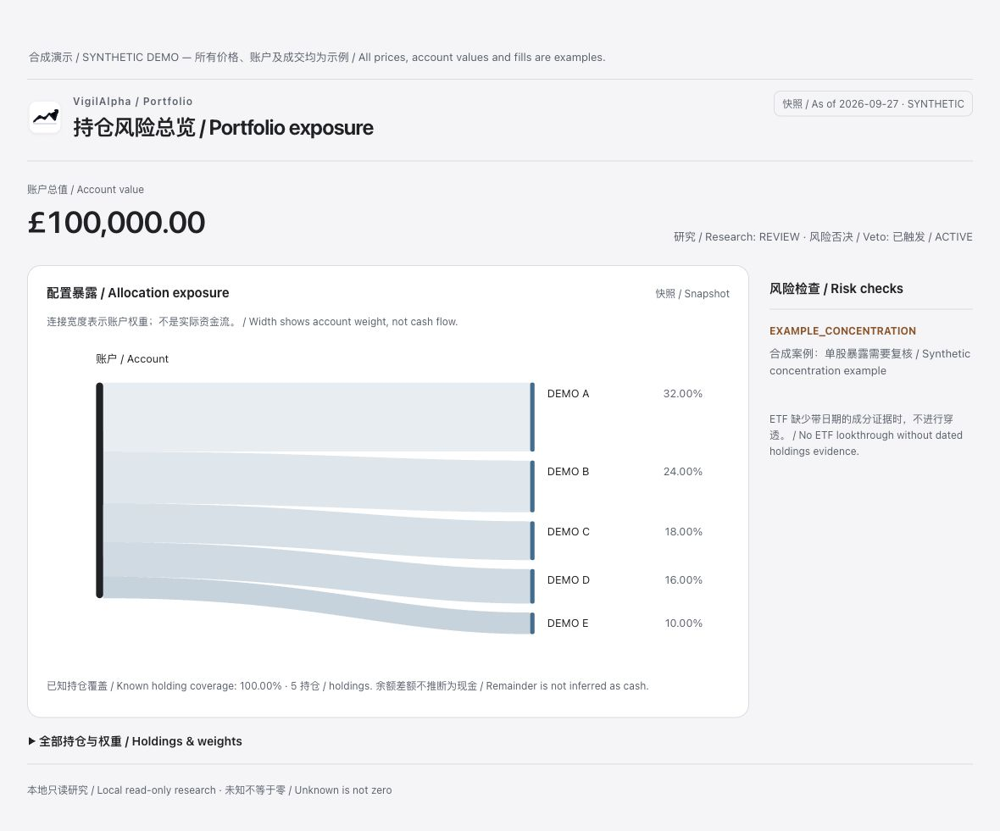
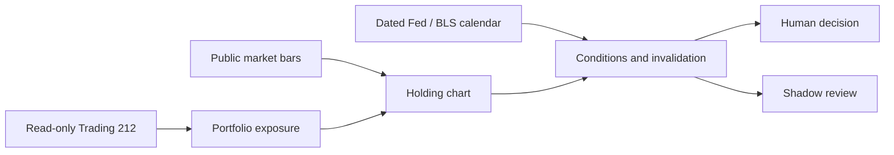
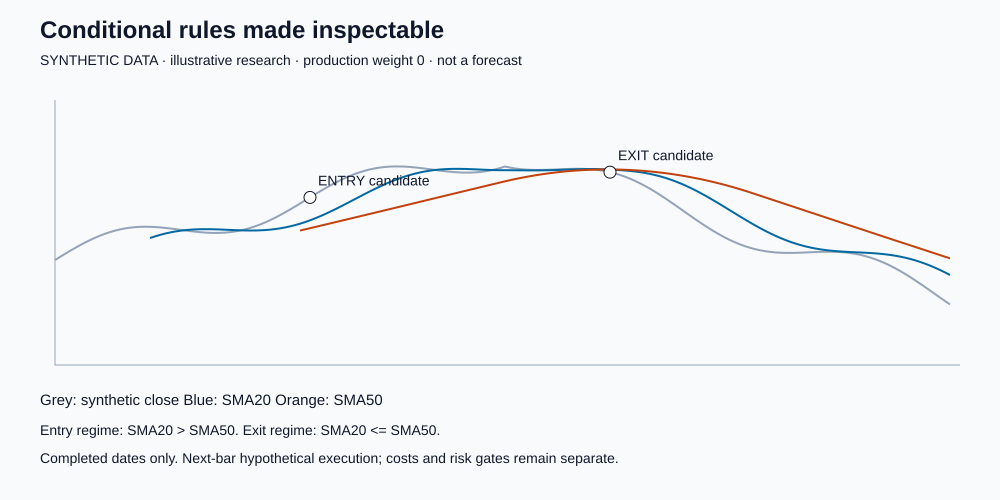

# VigilAlpha

**English** · [简体中文](README.zh-CN.md)


VigilAlpha is a local-first, strictly read-only Trading 212 risk-review plugin for Codex. It brings
account facts, transaction markers, data-quality checks, strategy evidence and conditional risk
decisions into one conversation. It cannot place, change or cancel an order.

Current development version: `0.1.0-dev.14` · License: MIT · Platform: macOS first

> Development prerelease: conditional research is experimental and account/UI acceptance is still
> incomplete. Public `v1.0` and plugin-directory approval remain separate gates. No strategy here
> is a promise of investment profit.

## What it does

Start with portfolio exposure, inspect one holding, review the dated evidence and decide for yourself.
The chart-first workspace supports candles/lines, available daily-bar windows, cost/fill toggles,
separate experimental markers, manual System/Light/Dark appearance and reduced-motion preferences.
The allocation ribbons show exposure, never actual cash flows. Holding research includes both price and account-exposure views; candle/line is a display toggle. Charts are snapshots, not streaming feeds.

Use **Refresh** after a broker action. It attempts all account sections while respecting broker limits, keeps old facts on failure and labels positions/history retrieval times separately. It is not an automatic per-trade subscription; broker publication and market-data delays still apply. Hosts without App tool calls retain the chat refresh path.




This is the running local HTML resource with synthetic prices/account/fills, not a real account or
proof of the Codex widget bridge. The controls are functional; the demo does not fetch market data.



- Verifies Trading 212 credentials locally before saving them to macOS Keychain.
- Reviews concentration, account reconciliation, missing data and independent risk vetoes.
- Reconstructs owned-position transactions and chart markers from read-only account history.
- Explains six strategy modules without presenting an experimental rule as validated.
- Makes three numerical entry/exit research rules inspectable and distinguishes them from fills.
- Lists dated official event schedules, observation conditions and stale-source warnings.
- Reviews public symbols without refreshing a private account; chart payloads are opt-in.
- Saves owner-only derived snapshots for genuine “what changed?” comparisons.
- Produces conditional shadow `REDUCE` plans for supported concentration breaches and `WAIT`
  when evidence is incomplete. Directional `ADD` and `EXIT` production plans remain blocked.
- Keeps daily strategy validation and shadow outcomes on explicitly identified daily bars.
- Evaluates shadow outcomes only with verified matching price currencies and eligible decisions.

The three technical rules are a starting point. The [bilingual research framework](docs/RESEARCH_FRAMEWORK.md)
maps primary papers to macro surprises, business/valuation evidence, horizons, execution costs,
portfolio risk and out-of-sample validation, and labels what remains unimplemented.

## Connected workflow and honest coverage

| Connection | Available | Boundary |
|---|---|---|
| Trading 212 API | Local read-only account/history reviews | Broker-page reconciliation still open |
| Public market data | Symbol research, optional charts | Not a streaming feed; verify venue and currency |
| Fed / BLS | Dated schedule snapshot in research context | No live expectations or outcome prediction |
| Codex | Tools, inline resources and secure setup | Current-host mounting and widget acceptance are separate checks |
| Chrome / ChatGPT sidebar | Symbols supplied by an authorized host | No automatic DOM access; full bridge unaccepted |
| Obsidian / Blackstone | Optional local candidate-research workflow | Not a default customer integration or model training |
| Yahoo / BBC / Apple News / Longbridge | Possible linked manual research material | Not all are automated connectors or licensed commercial feeds |

The formal interface is the Codex conversation and its inline cards. The former Vesper browser
dashboard remains available for one compatibility release but is not the product's default path.



The image is generated from synthetic data by the same rule core. It illustrates research
conditions, not a real account, live signal or investment return.

## Requirements

- macOS 14 or later
- Node.js 22 or later
- Codex desktop or Codex CLI with plugin support
- Trading 212 Invest or Stocks ISA read-only API credentials for account mode; public-symbol research does not require them

## Install from source

```bash
git clone https://github.com/ChristanBai/Vesper.git VigilAlpha
cd VigilAlpha
codex plugin marketplace add "$PWD"
codex plugin add vigilalpha-codex@vigilalpha
```

Restart Codex and open a new conversation. Select `VigilAlpha` under `+` → More/Plugins, mention
`@VigilAlpha`, or use `/plugins` in Codex CLI. Ask “检查设置和当前运行版本” to open the secure
setup card. Never paste an API key or secret into chat.

Download the development ZIP and checksum from the
[dev.14 prerelease](https://github.com/ChristanBai/Vesper/releases/tag/v0.1.0-dev.14).
See [the installation guide](docs/INSTALL.md) for permissions, setup and verification.

## Public tools

| Tool | Purpose |
| --- | --- |
| `setup_status` | Keychain, account-verification, market-source and local-data status |
| `portfolio_review` | Portfolio risk, risk vetoes, data quality and review queue |
| `holding_review` | Account facts, evidence, strategy modules and research signal |
| `strategy_review` | Strategy source, maturity, validation and cost disclosure |
| `market_review` | Compact public-symbol conditional rules; optional last-120-bar chart |
| `event_review` | Dated official calendar snapshot, scenarios and freshness limitations |
| `decision_review` | Conditional shadow action, quantity and estimated economics |
| `learning_review` | Shadow outcomes, failures and human promotion gate |
| `portfolio_changes` | Compare actual saved derived snapshots |
| `monitor_review` | Quiet material-change check for scheduled reviews |
| `local_data` | Local status, export and explicitly confirmed deletion |

`configure_credentials` is app-only. The model cannot call it and credential values are not
returned to the conversation.

## Trading 212 permissions

Enable only the read permissions needed for account data, portfolio, Pies, order/transaction/
dividend history and metadata. Do **not** enable `Orders - Execute` or `Pies - Write`. The client
rejects every non-GET Trading 212 request in code.

## Local data and privacy

- API credentials are stored in macOS Keychain, not project files or chat.
- Normalized cache, configuration and derived history remain local with owner-only permissions.
- Cloud sync and telemetry are disabled.
- Tool summaries and chart output are supplied to the Codex host; model processing/retention follows
  the user's host settings. Local storage does not mean no data enters model context.
- API response bodies are excluded from failure messages.
- `local_data` provides export and deletion; deletion requires the explicit confirmation phrase.

See [SECURITY.md](SECURITY.md) before reporting a vulnerability. Never include credentials,
account identifiers, holdings or transaction details in a public issue.

## Development

```bash
cd plugins/vesper-codex
npm run check
npm test
```

Build the same installable archive used by CI:

```bash
./scripts/build-release.sh
(cd dist && shasum -a 256 -c vigilalpha-codex-0.1.0-dev.14.zip.sha256)
```

Read [CONTRIBUTING.md](CONTRIBUTING.md), [CHANGELOG.md](CHANGELOG.md) and the current
[release checklist](RELEASE_CHECKLIST.md) before proposing a release.

For an account-free, deterministic UI preview run `node scripts/preview-workspace.mjs` from the
plugin directory. It binds only to localhost; every account, bar and fill is synthetic. Stop with Ctrl+C.

## Status boundary

Passing unit tests proves deterministic code paths, not investment performance. A strategy remains
experimental until its historical, out-of-sample, cost and shadow-observation gates are recorded
and a human approves promotion. Missing evidence produces `WAIT`, not a fabricated direction.

Browser scope: `market_review` accepts symbols supplied by a user or an authorized browser host.
It does not itself read Chrome tabs. A ChatGPT sidebar needs its own supported browser/MCP access;
installing this local stdio plugin does not establish web-side connectivity. Browser-to-ChatGPT
acceptance remains open. The first scheduled-event snapshot was checked on 2026-10-24 and expires
for reliance after seven days; it is not a live news feed or Fed decision forecast.
