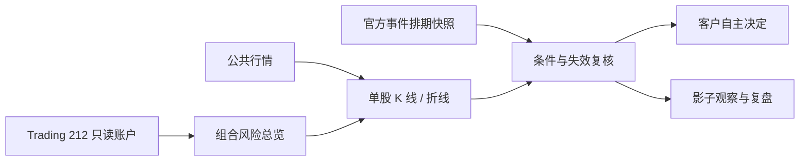

# VigilAlpha

[English](README.md) · **简体中文** · [下载 dev.15](https://github.com/ChristanBai/VigilAlpha/releases/tag/v0.1.0-dev.15)


在 Codex 中连接 Trading 212，把持仓事实、价格图表、已知事件和研究条件放进同一条决策路径。
先看组合里哪里需要关注，再研究单只股票的证据、进入条件和失效条件。

当前版本 `0.1.0-dev.15` 是公开开发预发布版，适合体验与研究反馈。它不能下单，也不保证盈利。
软件发布、客户使用路径验收与策略有效性分别核验；完整浏览器侧栏路径仍未验收。

## 一条连贯的研究路径


这是实际 HTML 界面的合成数据演示，控件可交互；不代表真实账户或 Codex widget bridge 已验收。



- **组合总览**：账户到持仓的桑基式配置暴露图、集中度与不可隐藏的风险否决。暴露不是资金流。
- **单股研究**：K 线／折线、平均成本、真实历史成交 B/S 与账户暴露桑基图同页共存；实验候选用独立的 ◇ 标记。单股图表示该持仓与其余账户价值，不虚构公司收入或供应链。
- **交易后刷新**：点击刷新尝试重新读取账户分区，分别显示持仓与成交历史的成功读取时间，失败保留原图并遵守限流。当前不是每笔交易自动实时推送；券商公布与行情延迟仍存在。宿主不支持工具调用时，可在聊天中请求刷新。
- **事件背景**：图表旁显示官方排期的核验日期与刷新要求。它不预测美联储决定、政治事件或价格涨跌。
- **条件与反证**：三类已实现数值规则是研究起点；[更完整的研究框架](docs/RESEARCH_FRAMEWORK.md)区分宏观、公司、估值、周期、价量、费用与仓位。
- **复盘**：只比较真实保存的派生快照；影子结果受币种、日线、样本与人工晋级门禁约束。
- **视觉**：系统字体、手动选择跟随系统／浅色／深色主题、图表优先、证据按需展开，动画尊重“减少动态效果”。


上图是合成数据计算说明，不是真实客户账户、实时信号或绩效证明。

## 联动边界

| 来源／宿主 | 已实现 | 尚未实现或尚未验收 |
|---|---|---|
| Trading 212 API | 本地只读账户、持仓、历史 | 网页逐项人工对账仍开放 |
| 公共行情 | 明确代码的研究、按需图表 | 不是持续推送实时行情；交易所身份必须核对 |
| Fed / BLS | 有日期与失效提示的排期快照 | 不包含实时预期或公布意外估计 |
| Codex | MCP 工具、内嵌资源、安全配置卡 | 新版本挂载与真实图表交互须分别验收 |
| Chrome / ChatGPT 侧栏 | 可接收授权宿主提供的证券代码 | 不自动读取网页；完整连接尚未验收 |
| Obsidian / Blackstone | 本地研究流程可保存候选知识 | 不是每位客户默认拥有的连接，不会自动改策略 |
| Yahoo / BBC / Apple News / Longbridge | 可作为有链接和日期的人工研究材料 | 未提供上述全部平台的自动连接或商业数据授权 |

## 安装与一次配置

要求：macOS 14+、Node.js 22+、支持插件的 Codex。公共股票研究不需要账户密钥；
账户分析需要 Trading 212 Invest／Stocks ISA 只读 API 权限。

```bash
git clone https://github.com/ChristanBai/VigilAlpha.git VigilAlpha
cd VigilAlpha
codex plugin marketplace add "$PWD"
codex plugin add vigilalpha-codex@vigilalpha
```

安装后重新打开 Codex 会话，启用 VigilAlpha，询问“检查设置与运行版本”。在安全配置卡输入一次
Key／Secret，验证后保存到 macOS Keychain；更换环境、撤销密钥等情况需要重新配置。
**不要把密钥粘贴到聊天中，也不要开启订单执行或 Pie 写入权限。** 详见[安装说明](docs/INSTALL.md)。

可以这样使用：

> 检查我的组合风险，不保存快照。然后选择最需要复核的一只股票，显示图表、证据缺口和失效条件。

> 研究 NVDA，显示 K 线、实验候选与未来30天官方事件；区分事实和假设。

## 隐私与验证

凭据在本地 Keychain；插件不设置独立云同步或遥测。工具摘要与图表会交给 Codex 宿主，
其模型处理和留存由用户的 Codex 设置决定，不能将“本地存储”理解为“任何数据都不进入模型上下文”。
不得把真实账户数据提交到公开 GitHub。安全反馈见 [SECURITY.md](SECURITY.md)。

```bash
cd plugins/vesper-codex
npm run check
npm test
node scripts/preview-workspace.mjs
```

最后一个命令启动仅绑定本机的合成界面预览，不读取账户、不抓行情；Ctrl+C 关闭。
发布检查见 [RELEASE_CHECKLIST.md](RELEASE_CHECKLIST.md)，研究与样本外验证要求见[研究框架](docs/RESEARCH_FRAMEWORK.md)。
MIT 许可证。策略晋级需要独立证据和人工批准，界面变漂亮或测试通过都不能证明收益。

## 策略学习有形入口

在 Codex 中问「打开 VigilAlpha 策略研究笔记本」，调用 `research_notebook`，无需账户密钥，返回来源、候选规则、反证与验证缺口。
导出实体文件（目标目录必须不存在）：

```bash
cd plugins/vesper-codex
node scripts/research-notebook.mjs export /absolute/path/to/new-notebook
```

生成 INDEX.md、registry.json 和4张规则研究单，含可计算条件、来源、冻结实验、费用/基准、反证和人工决定；未运行结果标 NOT_RUN。
用 Obsidian 打开此普通Markdown文件夹；既有Blackstone按其收录流程处理，不把模板当已验证知识。
自动学习关闭，笔记不会改变运行参数。旧称 Vesper，以及会话中的 Whisper MCP/Panel，统一以 VigilAlpha 介绍，旧技术标识保留兼容。
