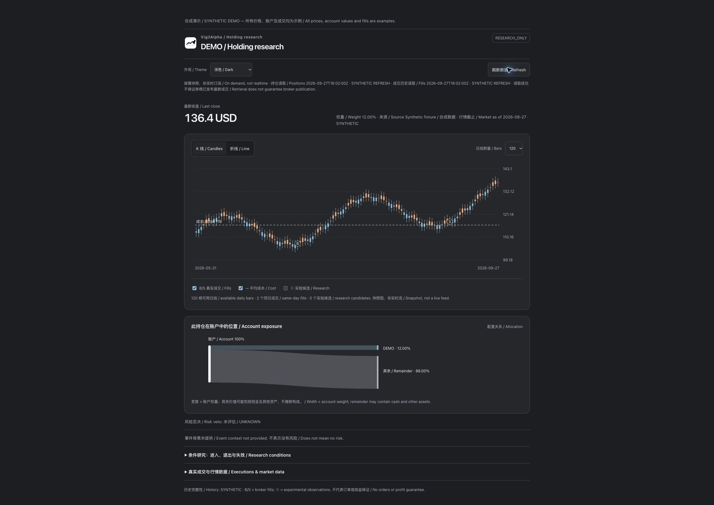
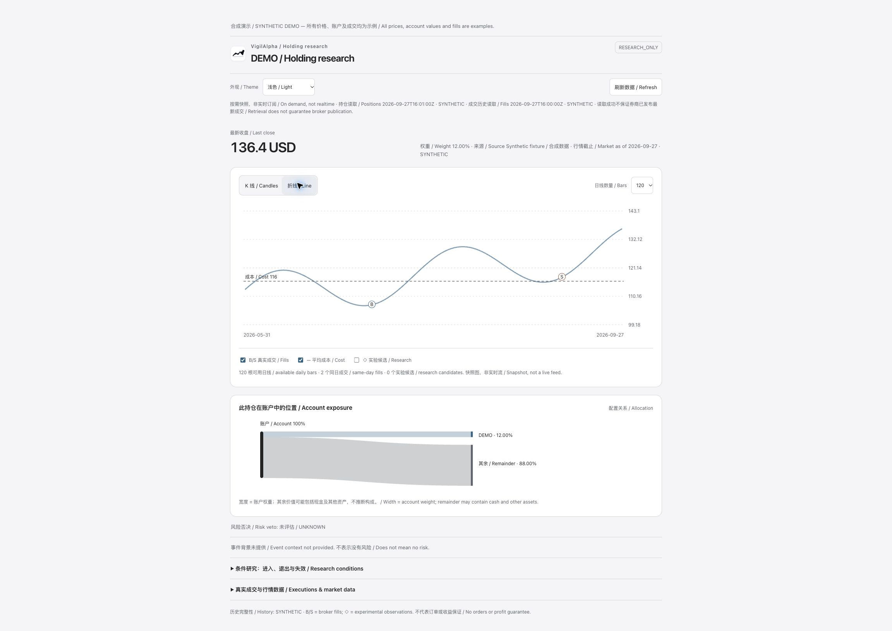
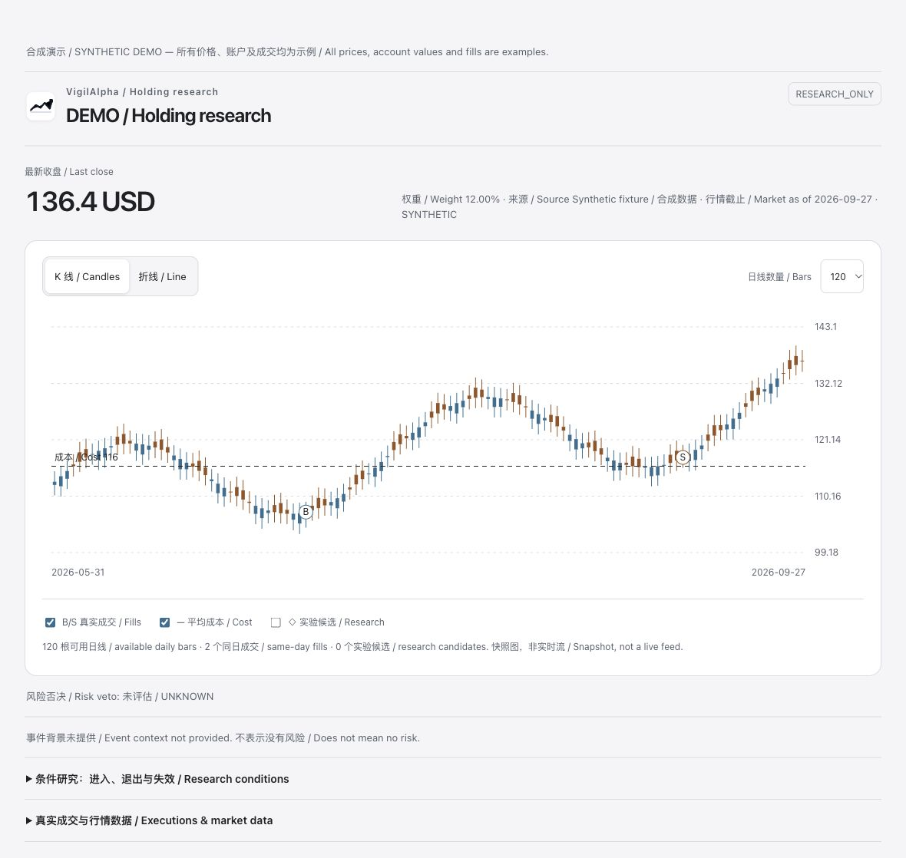
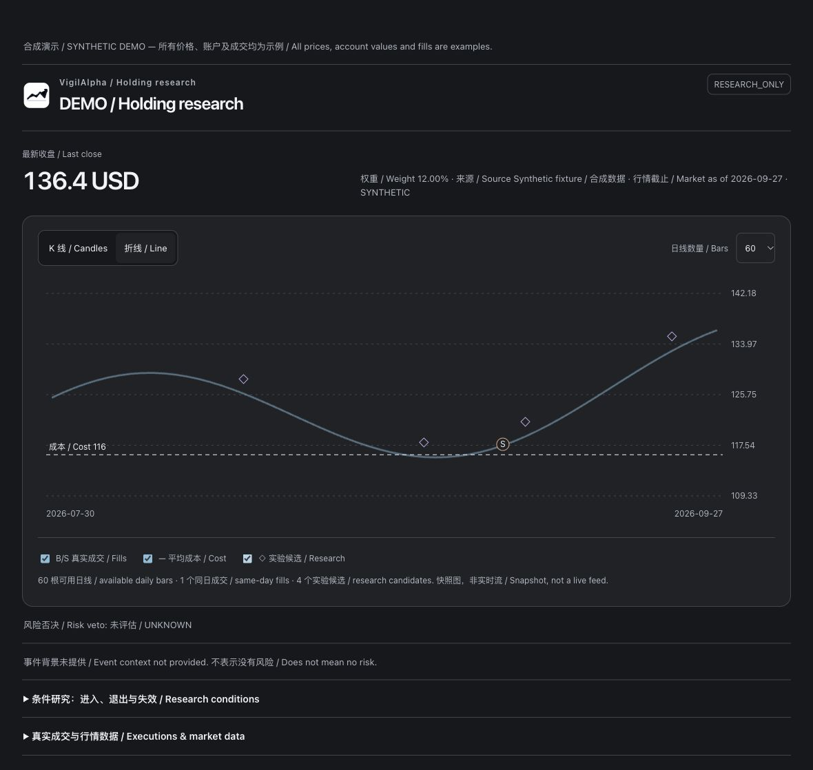

# dev.14 linked-view acceptance / 联动界面验收

2026-10-24. Actual Chrome local synthetic preview; no broker facts, live trade or real App bridge implied.
本轮使用真实浏览器操作本地合成页面；不代表券商对账或 Codex/ChatGPT bridge 已完成。

- Verified explicit Light/Dark/System selection, dark persistence across reload and portfolio route, and graceful operation when localStorage throws.
- Verified candle/line controls alongside a measured 12%/88% account-exposure ribbon. Unknown/invalid weights abstain; remainder is not cash or company revenue.
- Verified holding/portfolio refresh with fixture tool returns; separate retrieval timestamps update. Synthetic failure retains original prices and timestamps; error survives resize and chart toggles.
- Verified host-without-callTool fallback; empty bars/weight remain absent. At 390 px, document width equals scroll width and holding exposure uses a 340-wide viewBox with 12 px text.
- Browser review discovered failure messages disappearing on resize; fixed and rechecked. Actual Trading 212 page still displays a password field, so real post-fill latency and new-host rendering remain open.

The button is request-driven, subject to broker throttling/publication delay. No background trade listener,
automatic refresh subscription, order capability, issuer cash-flow graph or production strategy was added.
只读刷新不是自动实时订阅。下面保留 dev.13 的历史验收记录。

---

# UX acceptance / 界面验收

Date / 日期: 2026-10-24. Version / 版本: 0.1.0-dev.13.

## Design direction / 设计方向

System typography, restrained neutral surfaces, an exposure/price chart as the primary content,
and progressive disclosure of evidence. Preserve the original logo. Light/dark follows the host OS.
系统字体、中性色面、图表优先、证据按需展开，保留原 logo。不是原生 Apple 应用，也不声称得到 Apple 认可。

References / 参考：[Apple charts](https://developer.apple.com/design/human-interface-guidelines/charts)、
[Apple motion](https://developer.apple.com/design/human-interface-guidelines/motion)、
[TradingView Lightweight Charts](https://github.com/tradingview/lightweight-charts)。
The chart library is a reference only; no third-party runtime/CDN is bundled in this increment.
当前仍为本地 SVG，无远程脚本；未把快照冒称为实时流。Apple 页面正文抓取受 JavaScript 限制，未声称逐条完整审阅。

These are the actual HTML resource rendered with synthetic inputs through a local host shim.
它们是实际 HTML 界面加合成输入的截图，不能替代 Codex／ChatGPT bridge 验收。

## Executed checks / 已执行检查

| Path / 路径 | Evidence / 证据 | Status / 状态 |
|---|---|---|
| New holding UI / 新单股界面 | Candle/line switch; 30/60 bars; independent candidate toggle; fill count changes with date window / 图形、窗口、标记实际切换 | Verified in local preview / 本地预览已验证 |
| Responsive / 响应式 | 390 px document width = scroll width; main controls 44 px tall; responsive SVG keeps axis labels readable / 无页面溢出，坐标字号已修复 | Verified / 已验证 |
| Missing data / 缺失数据 | Empty chart hidden; price —; risk UNKNOWN / 不画假线，不填零或安全 | Verified / 已验证 |
| Allocation / 配置 | Five synthetic ribbons; 100% known coverage; empty notice hidden; exposure label / 五条暴露，空提示正确隐藏 | Verified / 已验证 |
| Real Codex setup / 真实配置卡 | Actual app-side Check status returned configured, read-only, environment credentials / 真点击返回配置状态 | Verified on mounted dev.11 only / 仅dev.11 |
| New mounted host / 新版本真实宿主 | Existing chat still runs dev.11 despite new installed cache / 安装不等于热加载 | Open / 未完成 |
| Trading 212 browser / 券商网页 | Actual tab remains at sign-in / 实际页面仍需登录 | Blocked by login / 登录阻塞 |
| ChatGPT sidebar / 网页侧栏 | Local stdio does not automatically expose a web connector / 需要受支持连接与页面权限 | Open / 未完成 |
| Keychain save / 密钥保存 | No new secret entered or saved during this acceptance / 本轮未输入凭据 | Unverified / 未验证 |

Browser visual inspection caught and repaired a reversed portfolio empty-state flag and illegible
narrow-chart coordinate scaling. Unit tests alone did not catch these issues.
目视检查发现并修复组合空提示反向、窄屏图表字号过小。不能用自动测试数量代替这些检查。

Figma concept work is separate: first composition failed its visual gate and the Starter MCP limit
prevented repair. It is not accepted as a finished design or included as release-ready artwork.
Figma 草稿布局验收失败，工具额度阻止修复；不将其称为完成稿，也不作为合格设计发布。
